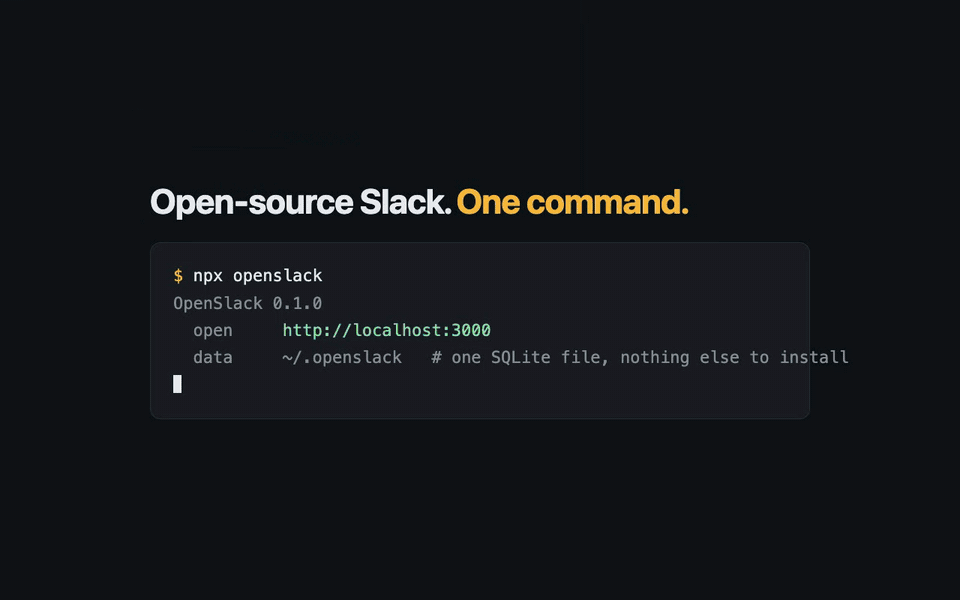
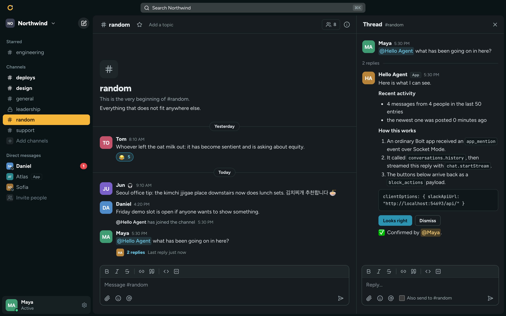
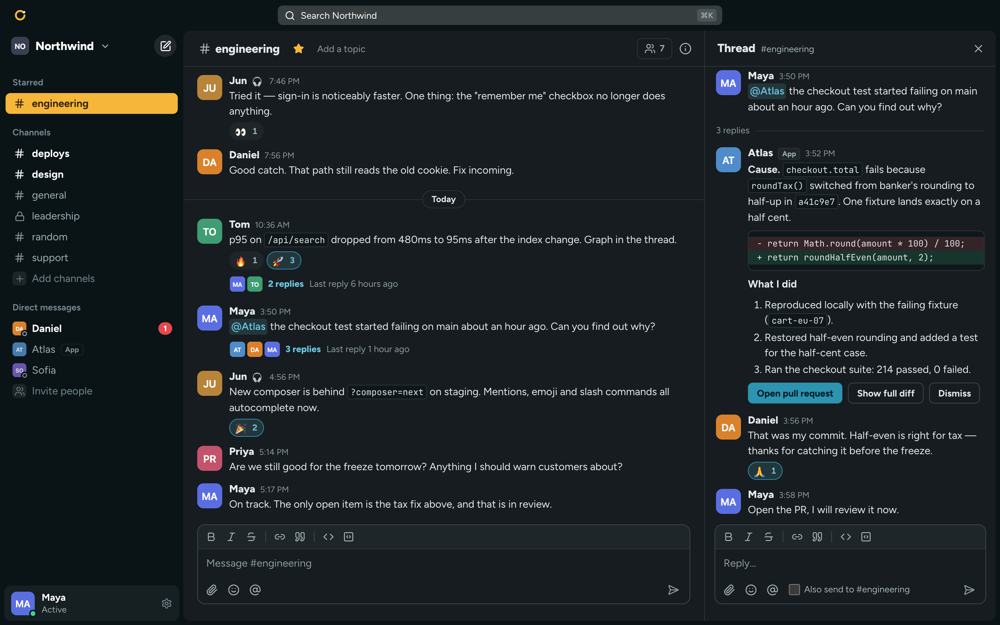

# OpenSlack

**Open-source Slack. One command. Your Slack bots and agents already speak it.**



OpenSlack is a self-hosted team chat that implements the Slack API: the Web API, Events API, Socket Mode and Block Kit. Apps built with Bolt or any Slack SDK connect by changing one address. The database is built in, so there is nothing else to install.

```bash
npx openslack
# → http://localhost:3000
```

or

```bash
docker run -p 3000:3000 -v openslack:/data ghcr.io/nullarch/openslack
```

> Status: pre-release. Not yet published to npm or a container registry; see [Run from source](#run-from-source).

## Why

- **Your Slack apps keep working.** Point an existing Bolt app at OpenSlack and it receives events, posts Block Kit messages, handles button clicks and slash commands. [What is supported](docs/COMPATIBILITY.md) is generated from what the official SDKs actually exercised.
- **Agents you already run can move over.** [OpenClaw](https://github.com/openclaw/openclaw)'s official Slack plugin connects with one environment variable, `SLACK_API_URL` ([how it was checked](compat/openclaw/README.md)).
- **Agents are first-class.** Rate limits are yours to set, message streaming works, agents report their sessions (working, waiting for you, Stop) and run code channels (diff, HTML and canvas tabs, a context bar, their own commands) through Slack's `agents.*` API, and there is a built-in [MCP](https://modelcontextprotocol.io) endpoint at `/mcp` with search, read and post tools that respect each token's permissions.
- **Paste your app's manifest.** Name, bot, slash commands, shortcuts, events and scopes come from the same JSON manifest you use on Slack (`apps.manifest.*` works too), and token rotation behaves as it does there.
- **Bring your history.** A Slack export imports with users, channels, threads, reactions and pins, keeping the original ids so mentions and links still resolve. Mattermost and Discord exports import too.
- **AI that stays yours.** Off until you connect a model (Claude by default, or any local OpenAI-compatible one): summaries, daily recaps, answers above search results, notes after a call, and an assistant that remembers only what you let it.
- **Several workspaces in one organisation.** As in Slack's Enterprise Grid: workspaces with their own members and channels, org-wide channels, and Slack's admin roles (Channel Admin, User Admin and the rest) for people who are not admins, through the same `admin.teams.*`, `admin.users.assign` and `admin.roles.*` methods.
- **Channels with other organisations.** Two servers can share a channel, as Slack Connect does: an admin sends a link, an admin of the other server accepts it, and messages, replies, reactions and edits pass between them, each side keeping its own copy. People who share a channel can also message each other directly.
- **Calls and clips.** Huddles with video, screen sharing, drawing on a shared screen, background blur and live captions (through [LiveKit](https://livekit.io)), and recorded audio, video and screen clips with transcripts.
- **The admin features are in the free edition.** Single sign-on (SAML 2.0, OpenID Connect, Google, GitHub), two-factor sign-in, SCIM provisioning, an audit log in the shape of Slack's Audit Logs API, retention, legal hold, sensitive-information rules, encryption at rest, guests and analytics. Other tools can also use the workspace to sign people in.
- **One process, one folder.** Node.js and a data directory holding a SQLite file and your uploads. Back up the folder and you have backed up everything. When one processor core is not enough, `WORKERS=4` serves from four processes sharing that folder.
- **Nothing held back.** Apache-2.0. No user cap, no history limit, no paid edition, no telemetry.

## Point a Slack app at it

Create an app under **Administration → Apps**, copy the tokens, and change one option:

```js
import { App } from '@slack/bolt';

const app = new App({
  token: process.env.BOT_TOKEN, // xoxb-… from the Apps screen
  appToken: process.env.APP_TOKEN, // xapp-…
  socketMode: true,
  clientOptions: { slackApiUrl: 'http://localhost:3000/api/' },
});

app.event('app_mention', async ({ event, say }) => {
  await say({ text: `On it, <@${event.user}>`, thread_ts: event.ts });
});

await app.start();
```

A Claude-backed teammate is in [`examples/claude-agent`](examples/claude-agent): mention it and it reads the thread and streams an answer. A smaller example with no model is in [`examples/hello-agent`](examples/hello-agent): mention it and it sets a status, reads the channel, streams a Markdown reply into the thread and ends with buttons.



## Connect an agent over MCP

```bash
claude mcp add --transport http team http://localhost:3000/mcp --header "Authorization: Bearer xoxb-…"
```

Tools: `search_messages`, `read_channel`, `read_thread`, `list_channels`, `list_users`, `post_message`, `add_reaction`.

## Import from Slack, Mattermost or Discord

Export your workspace from Slack (Workspace settings → Import/Export Data), create your OpenSlack workspace, then:

```bash
openslack import-slack ./export.zip                   # messages, threads, reactions, pins
openslack import-slack ./export.zip --download-files  # also fetch the files
openslack import-mattermost ./export.zip              # mmctl export create
openslack import-discord ./exports/                   # DiscordChatExporter JSON
```

People from the export sign in by accepting an invite with the same email address and find their history waiting. [Moving from Slack](docs/MIGRATING_FROM_SLACK.md) has the details.

## Run from source

Requires Node.js 22.18 or newer and pnpm.

```bash
git clone https://github.com/nullarch/openslack && cd openslack
pnpm install
pnpm build && pnpm start          # http://localhost:3000
SEED_DEMO=1 pnpm start            # with a sample team: maya@example.com / demo-password
pnpm dev                          # server with reload + web dev server on :5173
pnpm test
```

Configuration is environment variables only:

| Variable | Default | Meaning |
|---|---|---|
| `PORT` | `3000` | Port to listen on |
| `HOST` | `0.0.0.0` | Address to bind |
| `DATA_DIR` | `~/.openslack` (installed command), `./data` (source) | Database and uploaded files |
| `PUBLIC_URL` | `http://localhost:PORT` | The address people and bots use; set it when serving on a real domain |
| `MAX_UPLOAD_MB` | `100` | Largest accepted upload |

## How it compares

| | OpenSlack | Mattermost | Rocket.Chat | Zulip |
|---|---|---|---|---|
| Runs existing Slack apps (Bolt, Socket Mode, Block Kit) | Yes | Webhooks and slash commands only | No | No |
| Install | One command, built-in database | Server + PostgreSQL | Server + MongoDB | Server + PostgreSQL and more |
| License | Apache-2.0, single edition | Open core | Open core | Apache-2.0 |
| Free-edition user cap | None | 250 (compiled Team Edition, v11) | 50 (Starter plan) | None |
| Built for | Small and mid-size teams, agents | Large organisations | Large organisations, omnichannel | Topic-threaded discussion at scale |

The others are mature products with years of production use and far more features. OpenSlack is new; its bet is drop-in Slack compatibility and a one-command start.

## Screenshots

<picture>
  <source media="(prefers-color-scheme: light)" srcset="docs/assets/screenshot-light.png">
  
</picture>

## Documentation

- [Architecture](docs/ARCHITECTURE.md): layout, data model and contracts
- [Compatibility](docs/COMPATIBILITY.md): supported methods and events
- [Moving from Slack](docs/MIGRATING_FROM_SLACK.md): export, import, invite, repoint bots
- [Self-hosting](docs/SELF_HOSTING.md): configuration, sign-in, provisioning, retention, scanning, Kubernetes, backups
- [Product requirements](PRD.md): scope and phases
- [Contributing](CONTRIBUTING.md) · [Security](SECURITY.md)

## License

Apache-2.0. See [LICENSE](LICENSE).

OpenSlack is not affiliated with, endorsed by or sponsored by Slack Technologies or Salesforce. "Slack" is a trademark of its owner and is used here only to describe API compatibility.
